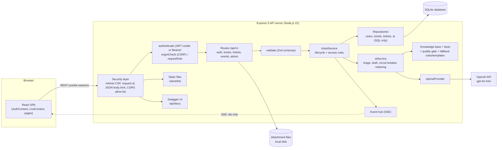
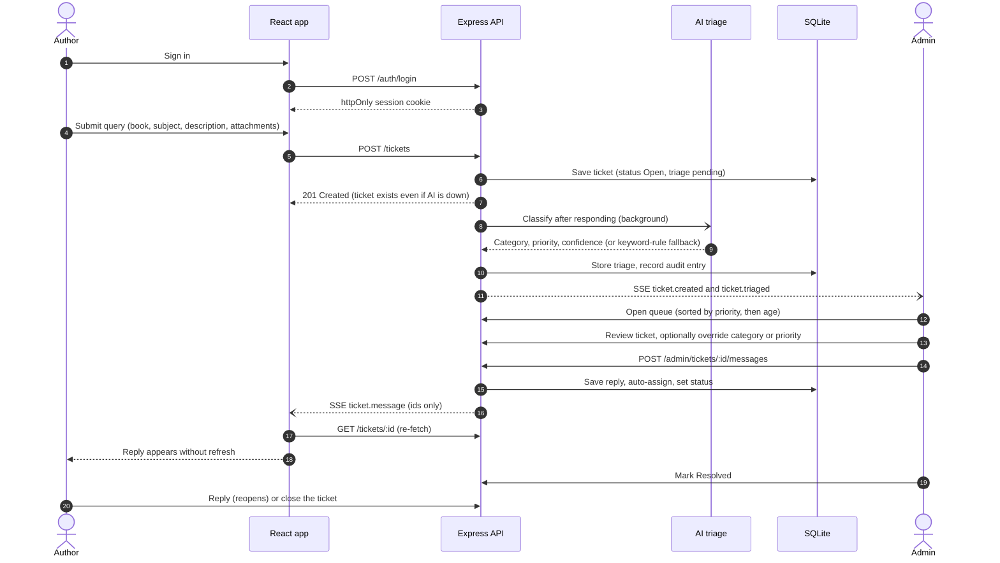
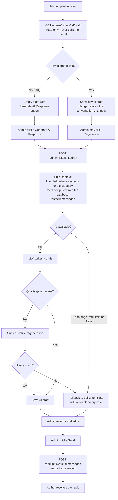
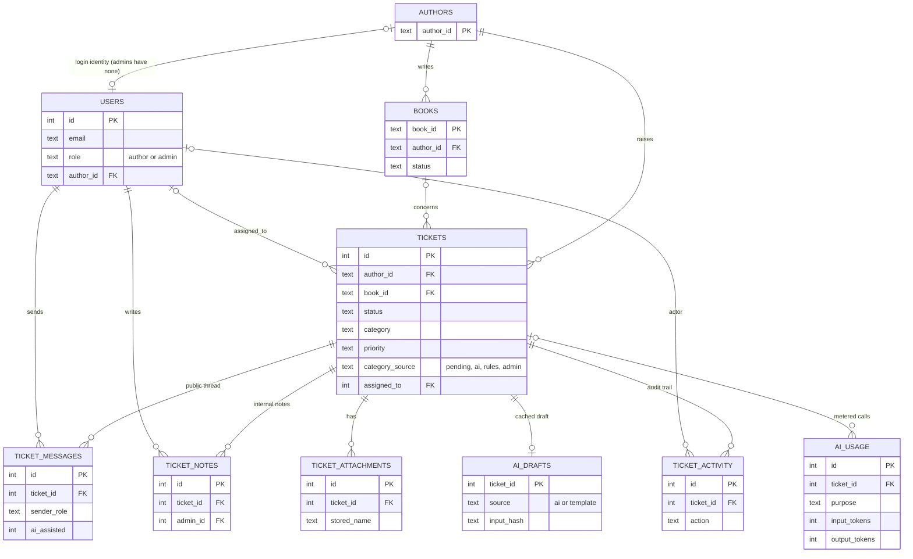
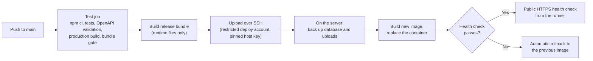

# BookLeaf Author Support & Communication Portal


A full-stack support portal for BookLeaf Publishing. Authors raise tickets about royalties, ISBNs, printing, distribution and production status; the operations team works one urgency-sorted queue, with **AI-assisted triage** and **AI-drafted replies grounded in the BookLeaf knowledge base**. A human reviews and sends every reply, and the system keeps working when the AI provider is unavailable.

| | |
|---|---|
| **Live application** | **https://bookleaf.206.189.178.199.nip.io** (HTTPS, deployed automatically from `main`) |
| **API documentation** | `/api/docs` (Swagger UI) on the live site, or locally at http://localhost:4000/api/docs |
| **Source code** | https://github.com/mohitchaudhary2207/bookleaf-author-support-portal |
| **Product walkthrough** | Provided with the submission as a video. It is not hosted in this repository. |
| **Demo logins** | [Demo credentials](#demo-credentials) |

## Table of contents

1. [Overview](#overview)
2. [Key features](#key-features)
3. [Demo credentials](#demo-credentials)
4. [Product screenshots](#product-screenshots)
5. [Technology stack](#technology-stack)
6. [System architecture](#system-architecture)
7. [Application workflows](#application-workflows)
8. [AI integration](#ai-integration)
9. [Database design](#database-design)
10. [API documentation](#api-documentation)
11. [Security](#security)
12. [Project structure](#project-structure)
13. [Local setup](#local-setup)
14. [Testing and quality](#testing-and-quality)
15. [Deployment and CI/CD](#deployment-and-cicd)
16. [Design decisions and trade-offs](#design-decisions-and-trade-offs)
17. [Known limitations and future improvements](#known-limitations-and-future-improvements)
18. [Author](#author)

---

## Overview

**The problem.** A publishing house answers the same kinds of author questions all day: "where is my royalty?", "my ISBN is wrong", "my copies arrived damaged". Done through email, these get lost, are answered in the order they arrive rather than by urgency, and need a support person to look up the author's book and royalty numbers before replying.

**Who uses it.**

- **Authors** sign in, see their own books, royalties and production progress, raise a ticket, and follow the conversation as it updates.
- **Support admins** work a single queue sorted by urgency, with the author's book data beside each ticket and a drafted reply ready on request.

**How it works.** When an author submits a ticket it is saved immediately. The system then classifies it into one of six categories and assigns a priority (Critical, High, Medium or Low), by AI when available and by keyword rules otherwise. The queue sorts unresolved tickets by priority and age and flags those past their first-response target. An admin can press **Generate AI Response** to get a draft written from the relevant knowledge-base sections and from facts the application computed from the database. The admin edits it and sends it, and the author sees the reply appear without refreshing.

**What makes it useful.**

- The AI **reads and drafts; a human decides.** Nothing is sent to an author automatically.
- Money and dates in a draft come from code, not from the model, and a quality gate checks them before the admin sees the draft.
- An AI outage never blocks a ticket from being created or answered.
- Opening a ticket never calls the model. AI cost is spent only when an admin asks for it.

## Key features

Only features that exist in the code are listed.

### Author portal

- **Authentication:** email and password sign-in. An author can only ever see their own data.
- **Dashboard:** books, royalties earned, paid and pending, and active tickets.
- **Book portfolio:** each book's status, sales, royalty figures, print partner and platforms. Unpublished books show a production-stage progress tracker.
- **Ticket submission:** pick a book (or "general"), subject, description, and up to 3 attachments (PNG, JPG, WEBP, PDF or TXT, 5 MB each).
- **Ticket tracking and conversation history:** a status for each ticket, a public message thread, replies (a reply to a resolved ticket reopens it), and closing a ticket.
- **Real-time updates:** new replies and status changes arrive over Server-Sent Events, without refreshing.

### Admin portal

- **Dashboard:** live ticket counts by status, priority and category, overdue and unassigned tickets, and average first-response time.
- **Ticket queue:** search plus filters for status, category, priority, assignee and date range. Sorted unresolved first, then by priority, then oldest first. Overdue tickets are flagged against per-priority first-response targets (Critical 4 h, High 24 h, Medium 48 h, Low 72 h).
- **AI-assisted classification and priority:** a category and priority with a confidence score and one-line rationale. Both can be overridden, and an override is never overwritten by a late AI result.
- **AI-generated response drafts:** produced on request from the **Knowledge Base** sections for the ticket's category plus computed facts. The admin edits the draft before sending.
- **Ticket management:** change status, assign to yourself or another admin, and reply to the author.
- **Internal notes:** staff-only, stored in a separate table from the public thread.
- **Audit trail:** every status change, override, assignment, reply and draft event is recorded.
- **AI and usage page:** AI availability, call counts, tokens and an estimated spend.

## Demo credentials

> **Assignment demonstration accounts.** These accounts exist only so the deployed BookLeaf assignment application can be evaluated, using the dataset supplied with the assignment. They are not real author or staff accounts and hold no real data.

| Account | Email / Login ID | Password | Role |
|---|---|---|---|
| Riya Mehta (Support Lead) | `admin@bookleaf.com` | `GPuru3G540GxQkczhKtf` | Admin |
| Aman Verma (Support) | `support@bookleaf.com` | `GPuru3G540GxQkczhKtf` | Admin |
| Ananya Reddy | `ananya.reddy@email.com` | `ldGDYiNvWljyiRI6OR6m` | Author |
| Arjun Malhotra | `arjun.malhotra@email.com` | `ldGDYiNvWljyiRI6OR6m` | Author |
| Diya Chatterjee | `diya.chatterjee@email.com` | `ldGDYiNvWljyiRI6OR6m` | Author |
| Farhan Sheikh | `farhan.sheikh@email.com` | `ldGDYiNvWljyiRI6OR6m` | Author |
| Kavita Deshmukh | `kavita.deshmukh@email.com` | `ldGDYiNvWljyiRI6OR6m` | Author |
| Meera Nair | `meera.nair@email.com` | `ldGDYiNvWljyiRI6OR6m` | Author |
| Priya Sharma | `priya.sharma@email.com` | `ldGDYiNvWljyiRI6OR6m` | Author |
| Rohit Kapoor | `rohit.kapoor@email.com` | `ldGDYiNvWljyiRI6OR6m` | Author |
| Sneha Kulkarni | `sneha.kulkarni@email.com` | `ldGDYiNvWljyiRI6OR6m` | Author |
| Vikram Joshi | `vikram.joshi@email.com` | `ldGDYiNvWljyiRI6OR6m` | Author |

Sign in at https://bookleaf.206.189.178.199.nip.io. Authors see only their own books and tickets; admins see every ticket. The same email addresses are seeded in local development, with the development-only passwords listed under [Local setup](#local-setup).

<details>
<summary>Dataset edge cases worth trying</summary>

- **Sneha Kulkarni**: *Midnight in Mysore* is in production (no MRP or sales; shows a progress tracker).
- **Ananya Reddy, Arjun Malhotra, Kavita Deshmukh (*The Nagpur Notebooks*), Diya Chatterjee (*Howrah Nights*)**: published and earning, but nothing paid yet.
- **Kavita Deshmukh**: *The Nagpur Notebooks* has ₹850 pending, below the ₹1,000 minimum payout (it rolls over); *Raising Roots* is in typesetting.
- **Farhan Sheikh, Priya Sharma's *Saffron Diaries*** and others: fully paid, ₹0 pending.

</details>

## Product screenshots

Screenshots are not stored in this repository. The product walkthrough video submitted with the assignment shows the author portal, the admin queue, and the explicit "Generate AI Response" flow. The live application can also be explored directly with the [demo accounts](#demo-credentials).

## Technology stack

| Layer | Technology | Purpose |
|---|---|---|
| Frontend | React 19, React Router 7, Vite 8, `lucide-react` icons, plain CSS design system | Single-page app for both portals |
| Backend | Node.js 22, Express 5 | REST API, business logic, static hosting of the built frontend |
| Database | SQLite via `better-sqlite3` | Persistence (WAL-capable single file, transactional) |
| AI | OpenAI `gpt-4o-mini` via the official SDK, strict function calling | Ticket classification, priority and reply drafting |
| Validation | Zod 4 | Request validation on every input |
| Authentication | `bcryptjs` password hashes, `jsonwebtoken` JWT in an httpOnly cookie (or `Bearer` header) | Sign-in and role-based access |
| Real-time | Server-Sent Events (in-process event hub, browser `EventSource`) | Live ticket updates |
| API docs | OpenAPI 3.0.3 + Swagger UI | Interactive documentation at `/api/docs` |
| Security middleware | `helmet`, `express-rate-limit`, `multer` limits, `cors` allow-list | Headers and CSP, throttling, upload limits |
| Testing | Node's built-in test runner, `supertest` | Server test suite |
| Deployment | Docker container on a cloud VM behind an nginx reverse proxy, Let's Encrypt HTTPS | Production hosting |
| CI/CD | GitHub Actions | Test, build, back up, deploy, health-check, roll back |

## System architecture



**Layering.** Routes parse and validate, then call a service. Ticket operations (list, create, reply, close, status and override changes, notes, drafts, attachment download) all go through `ticketService`, which owns the lifecycle rules and the access check. Repositories contain only SQL. A few read-only lookups (login, `me`, books, admin stats and lookups) call repositories directly, and contain no business rules.

**Composition root.** `server/src/container.js` is the only place concrete dependencies are chosen. Tests inject an in-memory database and a fake AI provider through it.

**Real-time events carry ids only.** The browser re-fetches through the normal REST API, so ticket authorization lives in one place.

## Application workflows

### Author ticket workflow



### AI-assisted admin workflow

Opening a ticket **does not** generate a draft. Generation happens only when the admin asks for it.



## AI integration

All AI code is in `server/src/services/ai/`. The model never acts on the system: it returns structured text, and a human decides what happens next.

**1. Classification and priority (one call).** `aiService.triage()` sends only the truncated ticket text and a one-line summary of the referenced book. It does not send the knowledge base or the thread. The model must answer through a forced, strict function call (`classify_ticket`) with an enum-constrained category and priority, a confidence value and a rationale shown to the admin. The prompt contains a priority rubric, and policy guardrails apply afterwards (for example, ISBN errors are never below High). Invalid output falls back to rules.

**2. Knowledge-base-grounded drafts.** A draft is built from:

- tone and voice rules in the system prompt (acknowledge first, be specific, own mistakes, give a timeline, end with a next step; printing complaints open with an apology);
- only the knowledge-base sections relevant to the ticket's category, plus calibration examples (`knowledgeBase.js`);
- **facts computed in code** from the database (`facts.js`, `royalty.js`): the book's numbers, the royalty cycle and payout deadline, the ₹1,000 minimum payout, overdue detection and production stage. The model does no date or money arithmetic;
- the last few thread messages, each truncated.

**3. Quality gate (`quality.js`).** Each draft is checked for greeting and sign-off, banned stock phrases, the printing apology, length, and grounding: every ₹ amount and date in the reply must appear in the supplied facts, knowledge base or ticket text. A failing draft is regenerated at most once, then replaced by a policy template.

**4. Admin review.** Drafts are labelled as AI-generated, shown in a distinct accent colour, and editable. The admin presses **Send**. Replies sent from a draft are flagged `ai_assisted` in the database.

**5. Fallbacks and error handling.**

| Situation | Behaviour |
|---|---|
| AI down, rate-limited, out of quota, bad key, timeout or no key | The ticket is still created (AI runs after the response). Triage uses keyword rules and is flagged for review. The draft is a labelled policy template. The admin can always write by hand. |
| Repeated failures | A **circuit breaker** pauses AI calls (4 consecutive failures, 60 s cool-down) while keeping the real failure cause visible to admins. |
| Invalid or low-quality model output | Schema validation or the quality gate, then at most one regeneration, then a template. |
| Late AI result after an admin override | Never overwrites a value whose source is `admin`. |

**6. Cost and usage tracking.** Triage is one call. Drafts are generated only on request, saved, and de-duplicated if two admins click at once. Generation is limited to 12 per minute per admin. Every call is recorded in `ai_usage` (tokens in and out, cached tokens, latency, failures) and shown with an estimated cost on the admin **AI & usage** page. Prices come from environment variables.

**7. Prompt-injection hardening (best effort).** Author text is fenced and escaped, and the system prompt treats it as data. The real safeguard is mandatory human review.

## Database design

SQLite, schema in [`server/src/db/schema.sql`](server/src/db/schema.sql) (applied on start-up).



Notable design choices:

- **Public messages and internal notes are separate tables**, so a faulty query cannot leak an internal note to an author.
- **Triage fields record their source** (`pending`, `ai`, `rules` or `admin`), so overrides are auditable and a late AI result cannot overwrite an admin's choice.
- **`ai_drafts`** holds one saved draft per ticket with an input hash, so a changed conversation can mark it stale without regenerating it.
- **`ai_usage`** records every model call, successful or not.
- Foreign keys are enforced (`PRAGMA foreign_keys = ON`), and ticket child rows are deleted with the ticket.

## API documentation

- **REST, versioned** under `/api/v1`; JSON in and out; role-based (`author` and `admin`).
- **Specification:** OpenAPI 3.0.3 in [`server/src/docs/openapi.yaml`](server/src/docs/openapi.yaml) (24 paths, 27 operations). It is validated by `npm run validate:openapi` and by a test that compares it with the implemented routes.
- **Interactive docs:** Swagger UI at `/api/docs`, raw JSON at `/api/openapi.json`.
- **Authentication:** session cookie (web app) or `Authorization: Bearer <token>` (API clients).
- **Validation:** Zod on every input. Errors always look like `{ "error": { "code", "message", "details?", "requestId" } }`, and validation failures return `422` with per-field `details`.

| API group | Role | Purpose |
|---|---|---|
| `POST /auth/login`, `POST /auth/logout`, `GET /auth/me` | public / any | Sign in, sign out, current user |
| `GET /health`, `GET /meta` | public / any | Liveness and AI availability; enums used by the UI |
| `GET /books`, `GET /books/:bookId` | author (own) / admin | Books with royalty summary |
| `POST /tickets`, `GET /tickets`, `GET /tickets/:id` | author (own) | Submit (JSON or multipart), list, view |
| `POST /tickets/:id/messages`, `POST /tickets/:id/close` | author (own) | Reply (reopens if resolved), close |
| `GET /tickets/:id/attachments/:attachmentId` | owner / admin | Authenticated attachment download |
| `GET /events` | any | Server-Sent Events stream |
| `GET /admin/tickets`, `GET /admin/tickets/:id` | admin | Queue with filters, sort and pagination; ticket detail with notes and audit trail |
| `PATCH /admin/tickets/:id` | admin | Status, category and priority overrides, assignment |
| `POST /admin/tickets/:id/messages`, `POST /admin/tickets/:id/notes` | admin | Reply to the author; internal note |
| `GET /admin/tickets/:id/draft` | admin | Read the saved AI draft (`204` if none); never calls the model |
| `POST /admin/tickets/:id/draft` | admin | Generate or regenerate a draft (the explicit action) |
| `POST /admin/tickets/:id/reclassify` | admin | Re-run AI triage |
| `GET /admin/stats`, `/admin/ai/status`, `/admin/ai/usage`, `/admin/admins`, `/admin/authors` | admin | Dashboard, AI health and cost, lookups |

Status codes used: `200/201/204`, `400` malformed JSON, `401` unauthenticated, `403` wrong role or CSRF, `404` not found (or not yours), `409` conflict (for example, replying on a closed ticket), `413` attachment too large, `422` validation, `429` rate limited.

## Security

### Implemented

| Control | Detail |
|---|---|
| Password hashing | `bcryptjs`. Login compares against a dummy hash for unknown emails and returns one generic error for both cases. |
| Authentication | JWT (12 h) in an **httpOnly, SameSite=Lax** cookie, `Secure` in production. `Bearer` tokens are also accepted for API clients. The user is re-read from the database on each request. |
| Role-based authorization | `requireRole` guards admin routes. `ticketService.loadAccessible` guards every ticket operation, including attachment download. Other authors' resources return **404, not 403**. |
| CSRF defence | Cookie-authenticated writes pass an `Origin` check against the host and the allow-list. |
| Input validation | Zod schemas on every route. SQL is always parameterised, and search wildcards are escaped. |
| Rate limiting | Login (30 per 15 minutes per IP) and AI draft generation (12 per minute per admin). |
| Security headers | `helmet` with a strict Content-Security-Policy; `x-powered-by` disabled. |
| Secrets | Read from the environment only. `JWT_SECRET` is mandatory in production (the server refuses to start without it). `OPENAI_API_KEY` stays on the server and `npm run check:bundle` fails a release if the frontend bundle contains a key-like string or demo credentials. |
| File uploads | Maximum 3 files of 5 MB each. Type allow-list (PNG, JPG, WEBP, PDF, TXT) checked by MIME type and extension. Files are stored under random names and served only through an authenticated endpoint as downloads. |
| Demo-data safety | In production, demo accounts are seeded only when explicitly enabled **and** passwords are supplied. There are no built-in production passwords. |
| Dependencies | `npm audit --omit=dev` reported 0 vulnerabilities when this README was written. |

### Not implemented (recommended)

Server-side session revocation, multi-factor authentication for staff, content sniffing and virus scanning of uploads, and a secrets manager. See [Known limitations](#known-limitations-and-future-improvements).

## Project structure

```
.
├── client/                      React 19 + Vite single-page app
│   ├── public/                  Favicon
│   └── src/
│       ├── api/                 Fetch client, data hooks, enum metadata
│       ├── components/          Layout, badges, conversation view, brand logo, demo panel (opt-in)
│       ├── context/             Auth, live (SSE) and toast providers
│       ├── pages/
│       │   ├── author/          Dashboard, books, tickets, new ticket, ticket detail
│       │   └── admin/           Dashboard, queue, ticket detail with AI composer, AI and usage
│       ├── styles/              Design tokens, base, components, shell and page styles
│       └── assets/              Self-hosted Lato font and the BookLeaf logo
├── server/
│   ├── data/                    Provided sample dataset used for seeding
│   ├── evals/                   Opt-in live AI evaluation harness
│   ├── scripts/                 OpenAPI validator
│   ├── src/
│   │   ├── app.js               Express app: headers, routing, error handling
│   │   ├── container.js         Composition root (dependency wiring)
│   │   ├── index.js             Entry point: seeding policy, start-up, graceful shutdown
│   │   ├── config/              Environment config and domain constants
│   │   ├── db/                  schema.sql, seeding and seeding policy
│   │   ├── docs/openapi.yaml    OpenAPI 3.0.3 specification
│   │   ├── middleware/          Auth and RBAC, CSRF origin check, validation, uploads, errors
│   │   ├── repositories/        SQL only: users, books, tickets, ai
│   │   ├── routes/              HTTP layer: auth, books, tickets, events (SSE), admin
│   │   ├── schemas/             Zod request schemas
│   │   ├── services/            ticketService, royalty maths, SSE event hub
│   │   │   └── ai/              aiService, OpenAI provider, prompts, knowledge base, facts, quality gate, fallbacks
│   │   └── utils/               Errors, logger, dates, async handler
│   └── tests/                   Test suite (Node test runner + supertest)
├── scripts/                     check-bundle.mjs (release gate), ui-check.mjs (opt-in browser check)
├── deploy/                      Release bundler, runtime Dockerfile, compose file, server-side deploy scripts
├── .github/workflows/           deploy.yml: the CI/CD pipeline
├── .env.example                 Environment template (no secrets)
├── Dockerfile, render.yaml      Alternative hosting files (not used by the production deploy)
└── package.json                 npm workspaces: server, client
```

## Local setup

**Prerequisites:** Node.js **22.9 or newer** and npm. Optionally an OpenAI API key.

```bash
git clone https://github.com/mohitchaudhary2207/bookleaf-author-support-portal.git
cd bookleaf-author-support-portal

npm install                        # installs server and client (npm workspaces)
cp .env.example server/.env        # then edit server/.env (see below)
npm run dev                        # API on :4000, web app on http://localhost:5173
```

- **Database:** created and seeded automatically on first start in development (`server/storage/bookleaf.db`). The provided dataset (10 authors, 18 books) plus 5 demo tickets are loaded into an empty database. Reset with `npm run seed -w server -- --force`, or delete `server/storage/bookleaf.db`.
- **Without `OPENAI_API_KEY`** the app runs in **manual mode** (rule-based triage and template drafts); everything else still works.
- **Production-style run:** `npm run build && npm start` serves the API and the built React app from one process on `$PORT`. Set `NODE_ENV=production` and `JWT_SECRET` (see the seeding rules in `.env.example`).
- **Local demo logins.** In development the seeded accounts use these documented development-only passwords: `Admin@123` for the two admin accounts and `Author@123` for the ten authors. They apply to local databases only and do not work on the deployed application.

<details>
<summary>Environment variables</summary>

| Variable | Purpose |
|---|---|
| `OPENAI_API_KEY` | LLM key. Server-side only, never sent to or bundled into the frontend. |
| `AI_MODEL` | Default `gpt-4o-mini`. |
| `AI_ENABLED` | `false` forces manual mode. |
| `AI_PRICE_INPUT`, `AI_PRICE_OUTPUT`, `AI_PRICE_CACHE_READ` | USD per 1M tokens, used only for the cost estimate on the admin AI page. |
| `JWT_SECRET` | **Required in production**; the server refuses to start without it. |
| `PORT`, `NODE_ENV` | Server port (default 4000) and environment. |
| `DATABASE_PATH`, `UPLOAD_DIR` | Storage locations (default `server/storage/...`). |
| `CORS_ORIGINS` | Only needed if the frontend is hosted on a different origin. |
| `SEED_DEMO_DATA` | Development: on unless `false`. Production: off unless exactly `true`. |
| `SEED_AUTHOR_PASSWORD`, `SEED_ADMIN_PASSWORD` | Passwords for seeded accounts. Production has no fallback and requires both (minimum 8 characters) whenever `SEED_DEMO_DATA=true`. |
| `VITE_SHOW_DEMO` | Build-time frontend flag. `true` adds a click-to-fill demo panel (embedding the demo passwords in the bundle). Default for production builds: off. |

</details>

### Scripts

| Command | What it does |
|---|---|
| `npm run dev` | API and web app with hot reload |
| `npm run build` | Production frontend build into `client/dist` |
| `npm start` | Start the server (serves the built frontend if present) |
| `npm test` | Server test suite (no network, API key or cost) |
| `npm run validate:openapi` | Strict OpenAPI 3.0.3 validation |
| `npm run check:bundle` | Release gate: fails if `client/dist` contains secrets or demo credentials |
| `npm run eval:ai` | Opt-in live AI evaluation against OpenAI (about 15 calls). `-- --offline` evaluates the fallback path with no API calls. |
| `npm run seed -w server` | Seed the dataset (honours the seeding policy) |

## Testing and quality

Results from the run made while preparing this README:

| Check | Command | Result |
|---|---|---|
| Server test suite | `npm test` | **113 tests in 24 suites in 10 files, all passing** (about 42 s) |
| OpenAPI | `npm run validate:openapi` | Valid OpenAPI 3.0.3: 24 paths, 27 operations, 23 schemas |
| Frontend build | `npm run build` | Succeeds (JS bundle about 358 kB, 113 kB gzipped) |
| Bundle gate | `npm run check:bundle` | No secrets or demo credentials in the built frontend |
| Dependency audit | `npm audit --omit=dev` | 0 vulnerabilities |

The suite uses Node's built-in runner and `supertest` with an in-memory SQLite database and a **fake AI provider**, so it needs no network or API key. It covers:

- **API and security:** authentication, cookie and CSRF handling, the role matrix, isolation between authors (including between their SSE streams), validation, attachments, queue filtering and sorting, overrides and the ticket lifecycle.
- **AI orchestration:** outage fallback, template drafts and recovery, draft caching and concurrency, invalid model output, the circuit breaker and failure-reason preservation, the quality gate, prompt-injection fencing and royalty-cycle maths.
- **Explicit AI generation:** opening a ticket makes zero model calls; a click makes exactly one; saved drafts are reused and flagged stale; nothing is sent until the admin posts.
- **OpenAI adapter:** the real SDK against a local mock of the API, checking request shape and error translation.
- **Seeding and release safety:** the seeding policy, real production start-ups against temporary databases, and real frontend builds checked for secrets.
- **OpenAPI:** the spec validates and matches the implemented routes.

**Live AI quality.** The opt-in `npm run eval:ai` run at release classified all 7 sample queries from the brief into the expected category and produced quality-gate-compliant drafts for 7 of 7. **6 of 7 samples passed their content checks.** The "my royalty seems too low" sample did not reliably explain the net-profit deductions, so it is the first prompt to improve. The check was deliberately not loosened.

**Not covered by the automated suite:** live OpenAI behaviour, the browser UI (checked with the opt-in `scripts/ui-check.mjs`, which needs `playwright-core`), SDK timeouts, and the login and draft rate limiters (disabled under test).

## Deployment and CI/CD

Production runs the application as a **Docker container** on a cloud VM. An nginx reverse proxy in front of it terminates HTTPS with a Let's Encrypt certificate. The container publishes no port of its own, and its database and uploads live in volumes outside the code.



The pipeline is defined in [`.github/workflows/deploy.yml`](.github/workflows/deploy.yml). Every push to `main` (and manual runs) goes through the same steps, and a failure stops the rest:

1. **Test:** `npm test`, `npm run validate:openapi`, `npm run build`, `npm run check:bundle`.
2. **Build the release:** [`deploy/make-release.sh`](deploy/make-release.sh) packages only runtime files (server source, sample dataset, built frontend, runtime Dockerfile). It refuses to include `.env` files, databases or uploads.
3. **Upload** over SSH through a restricted deploy account, with the server's host key pinned.
4. **Deploy on the server** ([`deploy/launch.sh`](deploy/launch.sh) then [`deploy/remote-deploy.sh`](deploy/remote-deploy.sh)): back up the SQLite database and uploads, build the new image, replace the container, and health-check it. A failed check restores the previous image and release automatically.
5. **Public health check** against the live HTTPS URL.

Only one production deploy runs at a time, and a running deploy is never cancelled part-way. **Pushes never change production data:** the local database is not copied, demo data is not re-seeded, and the data volumes are untouched. The app applies its own schema on start-up.

<details>
<summary>Making a change, rollback, backups and one-time setup</summary>

**Making a change**

```bash
npm test && npm run validate:openapi && npm run build && npm run check:bundle   # the same checks CI runs
git add -A && git commit -m "describe the change" && git push origin main
gh run watch                                                                      # optional: follow the deploy
```

**Rollback.** Automatic on a failed health check (data is not rolled back). If a release changed the database schema, restore the database from the pre-deploy backup instead.

**Backups.** Every deploy writes a database backup (SQLite online backup, readable by root only because it contains password hashes) and an uploads archive before changing anything. The 10 newest database backups and 5 newest releases are kept. **Backups are on the same server only**; copies to another location are not configured yet.

**GitHub repository secrets** (names only): `BOOKLEAF_SSH_KEY` (deploy key, CI only), `BOOKLEAF_HOST`, `BOOKLEAF_USER` (a restricted account, not root) and `BOOKLEAF_KNOWN_HOSTS` (the pinned host-key line).

**Server environment.** Production values (`JWT_SECRET`, `CORS_ORIGINS`, `OPENAI_API_KEY`, `AI_MODEL`, `SEED_*`) live in a root-readable environment file on the server and are never committed.

**Logs.** Run history with `gh run list` and `gh run view <id> --log`; container logs with `docker logs bookleaf`.

`render.yaml` and the root `Dockerfile` are kept for other hosts. The production path uses `deploy/Dockerfile.runtime` and `deploy/docker-compose.yml`.

</details>

## Design decisions and trade-offs

- **Layered backend (routes, services, repositories) with a composition root.** Business rules and access checks live in one place, SQL lives in another, and tests swap dependencies without mocking modules.
- **SQLite.** Zero operational overhead, transactional, and enough for this scope. The trade-off is a single writer on a single instance, which is documented below.
- **Server-Sent Events for real time.** Updates only flow server to browser, SSE rides on plain HTTP (cookies, proxies) and `EventSource` reconnects by itself. Events carry only ids, and the client resyncs after a reconnect. The trade-off is an in-memory hub, so several instances would need a shared pub/sub such as Redis.
- **AI generation is explicit.** The brief suggests presenting a draft when an admin opens a ticket. This implementation generates it only when the admin clicks **Generate AI Response**, and shows a saved draft immediately if one exists. This saves tokens and keeps the admin in control, at the cost of a few seconds' wait after the click.
- **The model reads, code calculates, a human decides.** Amounts and dates are computed by the application, checked by a quality gate, and reviewed by an admin before anything is sent.
- **Reliability over cleverness.** AI runs after the ticket is saved; failures degrade to rules and templates; a circuit breaker limits repeated failing calls; and a late AI result never overwrites an admin override.
- **A small model with structure around it.** `gpt-4o-mini` is cheap and fast and supports strict function calling. Quality is protected by structure (facts, quality gate, review) rather than model size, and that has limits, noted in [Testing and quality](#testing-and-quality).

**Assumptions.** "Quarterly" means calendar quarters, with payout due 45 days after quarter end. The dataset stores a flat royalty per copy while the knowledge base describes 80% of net profit, so the app shows the dataset's numbers and the AI explains the policy without recomputing amounts. ISBNs in the dataset are placeholders, so they are displayed but not validated. Authors are provisioned from the dataset; self-signup and password reset were out of scope.

## Known limitations and future improvements

**Known limitations**

- **Single instance:** the SSE hub is in-memory and SQLite is a single-writer file database.
- **Attachments** are on local disk, are not content-sniffed, and can only be added when a ticket is created, not on replies.
- **Sessions:** logout clears the cookie, but there is no server-side token revocation (12 h lifetime).
- Cookie-authenticated requests with no `Origin` header are accepted (mitigated by `SameSite=Lax`). Ticket creation is not idempotent, so a double submit creates two tickets.
- **AI answer quality:** live behaviour under provider rate limits, quota exhaustion and timeouts was verified only against mocks, and one live sample (royalty explanation) is inconsistent.
- **Backups** are on the same server, and rollback has not been exercised against a real failed deployment.
- The root `Dockerfile` has not been built, and the Render blueprint has not been deployed.

**Realistic next steps** (none of these exist today): PostgreSQL with migrations and off-server backups; Redis for SSE fan-out and shared rate limits; object storage with upload scanning; a job queue for AI work and notifications; observability and alerting; server-side session revocation and MFA for staff; a growing AI evaluation set from real tickets; author notifications; an accessibility audit.

## Author

**Developed by Mohit Chaudhary.**

This project was developed as a Full-Stack Developer technical assignment for BookLeaf Publishing.
